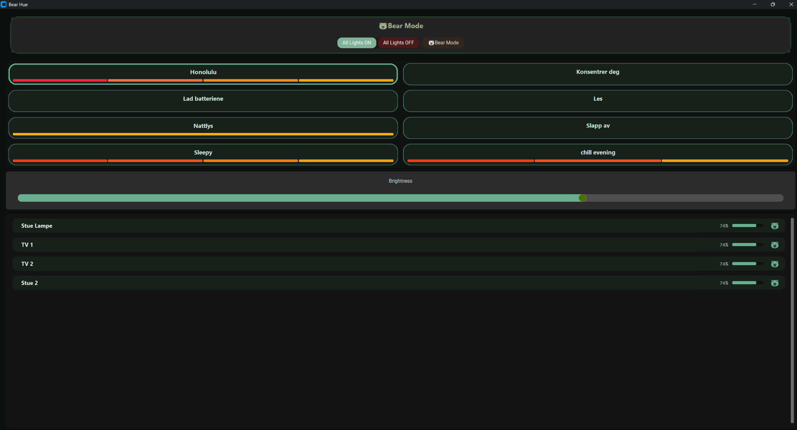
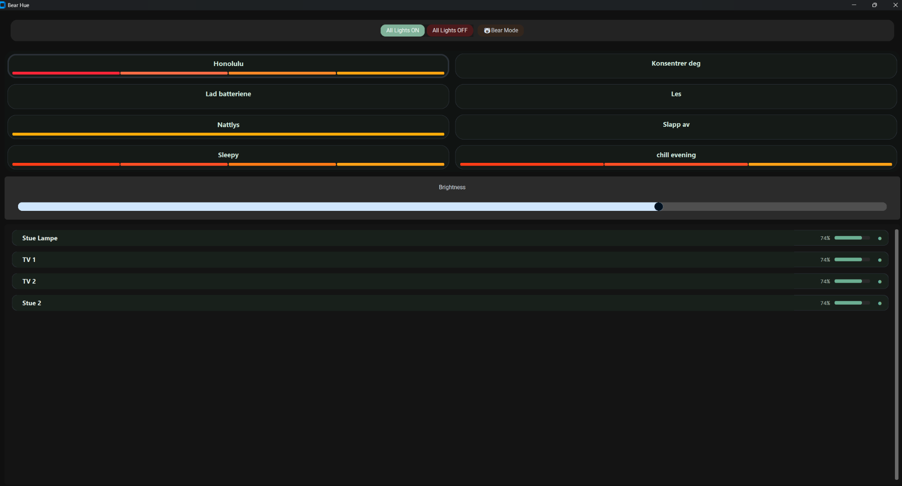

# Bear-Hue

A desktop application for controlling Philips Hue lights directly from your computer.

Bear-Hue lets you control your smart lighting, activate scenes, adjust brightness, and switch between lighting presets — all from a simple desktop interface built with Python and CustomTkinter.

## Screenshots

### Bear Mode
Bear Mode applies a custom look to the interface while keeping the lighting controls easy to access.



### Default interface
The main interface includes scene presets, a global brightness slider, and individual light controls.



## Features

- **Philips Hue integration** — communicate with your Hue Bridge to control lights.
- **Scene presets** — activate saved lighting scenes with color previews.
- **Global brightness control** — adjust brightness from the main window.
- **Individual light controls** — view and control lights separately.
- **All Lights On / All Lights Off** — quickly switch the lights on or off.
- **Bear Mode** — toggle the custom Bear-Hue interface theme.
- **Desktop executable** — build and run the app as a Windows `.exe`.

## Tech Stack

- Python 3.12
- CustomTkinter
- Pillow
- Requests
- Philips Hue API

## Setup

### 1. Set up Philips Hue access

Follow the Philips Hue developer documentation to learn how to connect an application to your Hue Bridge:

- [Philips Hue API getting started](https://developers.meethue.com/develop/hue-api-v2/getting-started/)
- [Discover your Hue Bridge](https://discovery.meethue.com/)

Make sure your computer can reach the Hue Bridge on your local network. Follow the authentication and pairing flow required by the API version used by your local configuration.

### 2. Install dependencies

Clone the repository and open a terminal in the project directory:

```bash
git clone <YOUR_REPOSITORY_URL>
cd <YOUR_PROJECT_DIRECTORY>
```

Create and activate a virtual environment:

```bash
python -m venv .venv
```

On Windows PowerShell:

```powershell
.\.venv\Scripts\Activate.ps1
```

Install the project dependencies:

```bash
pip install -r requirements.txt
```

If the repository does not contain a `requirements.txt` file yet, install the dependencies used by the project (`customtkinter`, `Pillow`, and `requests`) in the virtual environment.

## Run the App

Run the main application using the entry point configured in the repository. If your current entry point is `src/main.py`, use:

```bash
python src/main.py
```

## Tests

Run the API connection test:

```bash
python -m tests.test_api
```

Run the Hue service test:

```bash
python -m tests.test_service
```

## Utility Script

The script for testing basic light on/off control can be run with:

```bash
python -m src.scripts.main
```

## Current Status

- [x] Desktop UI
- [x] Scene system with color previews
- [x] Philips Hue API integration
- [x] Windows executable build
- [x] Global brightness control
- [x] Individual light list and controls
- [x] All Lights On / All Lights Off actions
- [x] Bear Mode UI toggle
- [ ] Refactor and simplify `update_state` logic
- [ ] Add a dedicated settings screen

## Future Ideas

- Dedicated settings UI
- More flexible light and scene configuration
- Additional lighting modes and presets
- Further UI polish and accessibility improvements

## Project Goals

Bear-Hue is a practical learning project focused on:

- Integrating an application with a real-world smart-home API
- Working with HTTP requests, authentication, and API responses
- Building desktop interfaces with Python and CustomTkinter
- Organizing application logic into maintainable services and modules
- Improving code quality through refactoring and clearer state management

---

Built as a personal project to make controlling Philips Hue lighting from the desktop simple and convenient.
